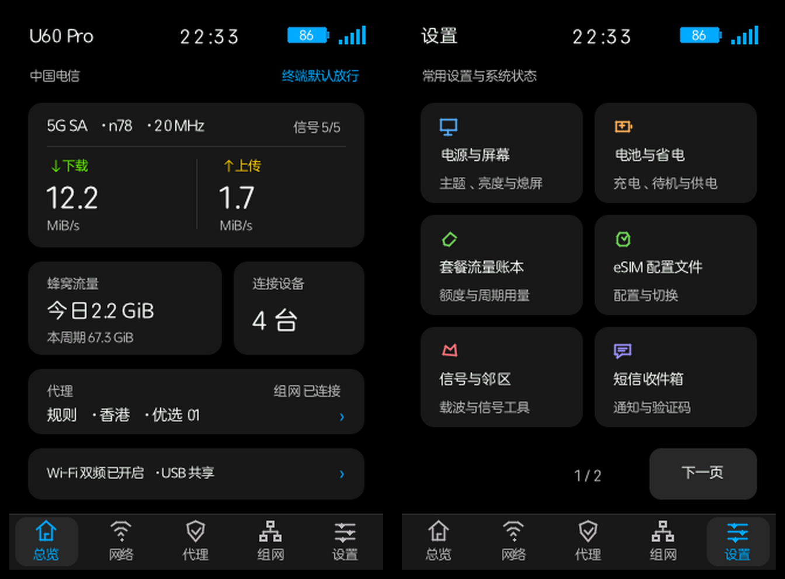
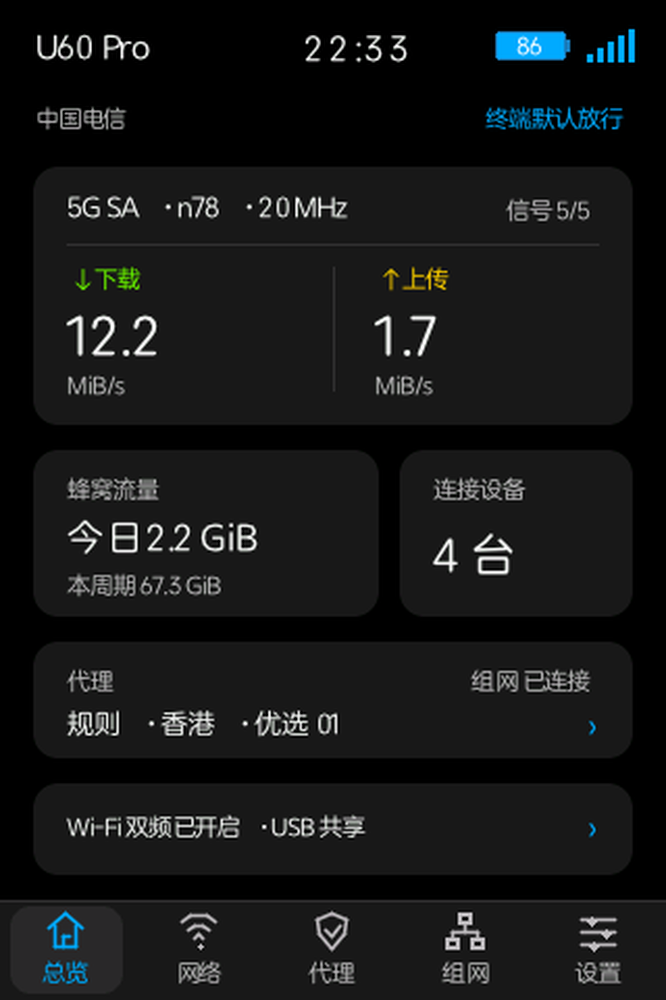
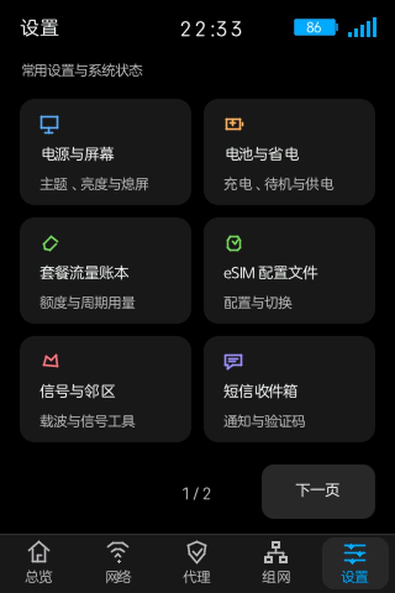
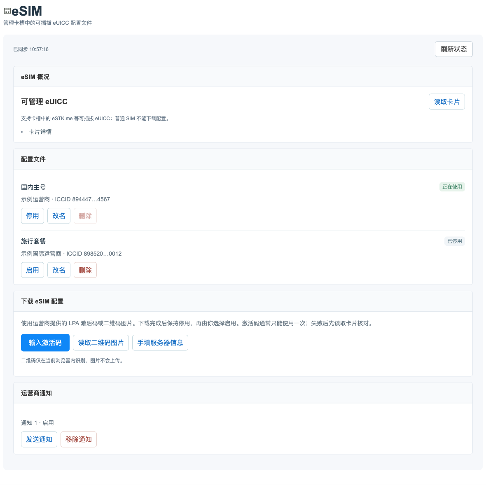

# U60 Pro Companion

U60 Pro Companion 是中兴 U60 Pro（MU5250）国行 B28 / B31 的增强伴侣系统：保留原厂固件、原厂网页和 ADB，同时把小屏状态、网络控制、代理、组网、套餐台账和设备维护整合到一套体验里。

当前版本：[v0.2.0-companion](https://github.com/gaofeng21cn/u60-pro-companion/releases/tag/v0.2.0-companion)。这是在多个开源项目基础上独立维护的产品版本，安装包、文档和设备端控制器由本仓库统一维护。

## 界面预览

小屏提供“深色”和“浅色”两个主题：深色主题取自原厂小屏的黑底、白字和状态色，浅色主题取自原厂网页的蓝白配色。两种主题共用同一套信息层级、边距系统和交互逻辑，双击电源键可在原厂界面与增强界面之间切换。









## 核心能力

| 能力 | 已完成内容 |
|---|---|
| 小屏控制中心 | 总览、网络、代理、组网、设置、套餐台账和 eSIM 入口；状态卡片、分页、按压反馈和双击切换与原厂操作节奏保持一致 |
| 移动终端联网 | 在原厂认证链路上增加设备侧状态保持，让中国移动终端联网不再受单一验证设备限制 |
| Clash / Mihomo | 订阅、节点偏好、规则/全局/直连、连接状态和实际接管诊断统一呈现 |
| Tailscale 组网 | 登录、设备访问、子网转发和出口状态集中管理，设备身份随安装升级保留 |
| eSIM 管理 | 读取卡片、查看 EID 与配置文件、下载、启用、停用、改名、删除和运营商通知 |
| macOS USB 直连 | B31 通过原厂 ECM＋ADB 提供免驱联网；数据线连接 Mac 后即可同时使用网络与 ADB |
| Wi-Fi 接力 | 保存上游 Wi-Fi、按优先级重连、失败重试和蜂窝回退，适合把 U60 Pro 当作 travel router |
| 套餐流量台账 | 按 SIM 卡槽、固定周期、额度和有效期记录蜂窝用量，支持 30 天周期统计 |
| 网页增强 | 沿用原厂登录与管理通道，提供总览、网络、代理、组网、电源、工具和 eSIM 页面 |

## 安装

1. 用 USB 数据线把 U60 Pro 连接到电脑，启用 root ADB，并确认电脑已经安装 Python 3 和 Google Android Platform Tools。
2. 让你使用的 Agent 在 GitHub 搜索 [`gaofeng21cn/u60-pro-companion`](https://github.com/gaofeng21cn/u60-pro-companion)，阅读本 README 和[安装说明](docs/INSTALL.md)，为当前设备生成绑定材料并执行安装。
3. 也可以直接下载 [v0.2.0-companion 安装包](https://github.com/gaofeng21cn/u60-pro-companion/releases/tag/v0.2.0-companion)后手动执行：

```sh
shasum -a 256 -c SHA256SUMS.txt
tar -xzf u60-pro-enhanced-v0.2.0-companion.tar.gz
cd u60-pro-enhanced-v0.2.0-companion
adb devices
python3 prepare.py
cd ../u60-prepared-private
python3 deploy-from-computer.py check
python3 deploy-from-computer.py install
python3 deploy-from-computer.py start
```

已经安装过本项目的设备使用原地升级：

```sh
python3 deploy-from-computer.py upgrade-check
python3 deploy-from-computer.py upgrade
```

安装完成后，先在小屏和原厂网页确认设备状态，再按需开启代理、Tailscale、Wi-Fi 接力或 Mac USB 直连。详细流程见[安装说明](docs/INSTALL.md)、[使用说明](docs/USAGE.md)和[恢复说明](docs/RECOVERY.md)。

## 适配设备

| 固件 | 设备标识 | 内核 |
|---|---|---|
| 国行 B28 | `BD_FLYMODEMMU5250V1.0.0B28` | `5.15.185-perf` |
| 国行 B31 | `BD_CNMU5250V1.0.0B31` | `5.15.194-perf` |

安装器会根据固件和设备身份生成绑定材料。`u60-pro-enhanced-*` 安装包目录、`/data/u60-panel` 和升级回退结构继续作为设备兼容标识使用。

## 从源码构建

开发构建需要 Zig 0.14.1、Go、Python 3、Rust 1.87+（含 `aarch64-unknown-linux-musl` target）、C 编译器和 Node.js：

```sh
ZIG=/path/to/zig-0.14.1 sh scripts/build.sh
sh scripts/test.sh
python3 scripts/package.py
```

默认产物为 `dist/u60-pro-enhanced-v0.2.0-companion/` 及同名压缩包。源码、主机测试、设备安装和真实业务验收分别记录在[产品基线](docs/BASELINE.md)、[验证范围](docs/VALIDATION.md)和主题文档中。

## 来源与许可

项目早期从 [defilippisprafka-netizen/u60-pro-enhanced](https://github.com/defilippisprafka-netizen/u60-pro-enhanced) fork，随后独立完善了小屏 UI、原厂网页增强、移动终端联网、Clash/Mihomo、Tailscale、eSIM、Mac USB、Wi-Fi 接力和套餐台账，并吸收了多个 GitHub 开源项目的实现经验。具体来源与许可证见[开源吸收对照](docs/UPSTREAM-LEARNING.md)、[LICENSE](LICENSE)和[第三方声明](THIRD_PARTY_NOTICES.md)。
